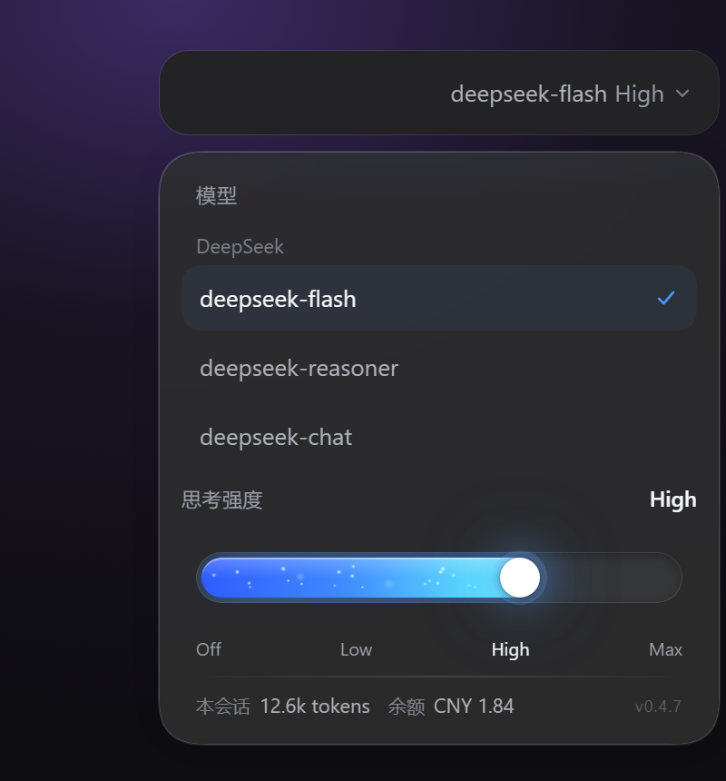
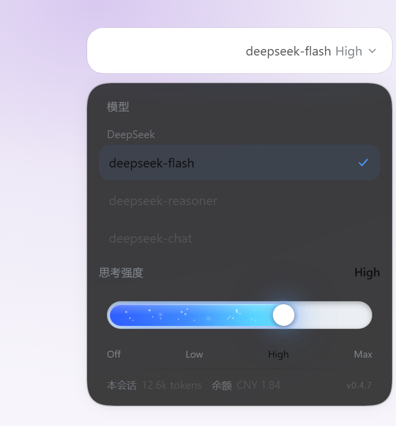

# dsh-plugin-effort-panel

把 DSH 输入框里的「模型选择」换成**Codex 风格的单层面板**：上半选模型，下半拖思考强度，一屏调完，不再点两级菜单。


左边是 DSH 原生的两级菜单：先选模型，再点进「推理等级」；右边是这个插件的一层界面。



<details>
<summary>浅色主题</summary>



</details>

## 特性

- **单层交互**：模型列表 + 思考强度滑条在同一个面板里，没有二级菜单。
- **跟随模型能力**：滑条档位来自 `modelDirectories` 公布的 `reasoning.efforts`，不硬编码 Off/Low/High/Max。
- **与官方状态同源**：读写都走官方 `modelDirectories.directoryFor(sessionId)`，和 `/model` 命令、原生菜单共享同一份选择。
- **拖动即生效**：连续跟手、松手吸附到最近档位；同档位去重 + 单请求在飞行中合并，快速拖动不会打爆 Host。
- **原生观感**：颜色、圆角、阴影全部取自 DSH 的 `--dsw-*` 设计变量，深色/浅色自动跟随。
- **会话统计**：底部显示本会话累计 tokens；登录 DeepSeek 账号后还会显示账户余额。
- **无障碍**：滑条是 `role="slider"`，支持方向键 / Home / End，Esc 关闭，点击外部关闭。

## 安装

DeepSeek Harness **0.2.1-rc.2 ~ 0.2.2** 的 Desktop 或 Web profile：

```powershell
# 桌面端
dsh plugin --profile desktop add github:DayMoon07/dsh-plugin-effort-panel#v0.4.7

# 浏览器版
dsh plugin --profile web add github:DayMoon07/dsh-plugin-effort-panel#v0.4.7
```

也可以直接装本地打好的包：

```powershell
dsh plugin --profile desktop add file:C:/path/to/dsh-plugin-effort-panel-0.6.7.tgz
```

安装后**完全退出再启动**（托盘右键退出，确认进程结束）。DSH 在启动时才会加载客户端的 bundle。

卸载：

```powershell
dsh plugin --profile desktop remove dsh-plugin-effort-panel
```

## 兼容性

| DSH 版本 | 状态 |
|---|---|
| 0.2.1-rc.2 ~ 0.2.2-rc.1 | 支持，已在 `0.2.1-rc.5` 与 `0.2.2-rc.1` 实测 |
| 0.2.0 及更早 | 未适配（插槽结构不同） |
| 0.3+ | 未知，可能需要跟随官方槽位改动 |

## 工作原理

这个插件很小：宿主半边是空的 `apply()`，所有逻辑都在浏览器侧的一个 bundle 里（`lib/client.js`，无构建步骤，改完直接生效）。

**1. 接管模型座位**

`conversation.input.model` 是单值槽位。插件先按 `priority: -100` 注册自己的座位，然后在 `slots/changed` 时遍历 `slots.entries(SLOT)`，把官方那条已经当选的条目的 `component` 换成自己的包装。这样无论槽位选举按优先级还是按注册顺序，渲染的都是同一个面板。

包装器会校验官方传入的 props（`directory.subscribe` / `select` 是否存在），不匹配时回退渲染原组件——所以官方改结构时最坏情况是退回原生菜单，而不是白屏。

**2. 为什么重设 `corner-shape`**

DSH 主题在 Chromium 140+ 上把全局圆角设为超椭圆：

```css
@supports (corner-shape: superellipse(1.5)) {
  :root { --dsw-corner-shape: superellipse(1.5) }
}
```

在这个模式下，`border-radius: 50%` 画出来的是"圆角方块"，不是正圆。插件对自己的元素显式声明 `corner-shape: round !important`，滑条两端和圆点才是真正的半圆/正圆。

**3. 余额为什么可能读不到**

余额来自 DeepSeek **平台账号**的远端接口，和模型用的 API Key 是两套凭据：

- 插件声明了 `remote` / `remote.account` / `locale` 三个服务；
- 未登录时接口返回 `null`，插件显示 `未登录`；
- 登录后调用 `getBalance({ version, locale, timezoneOffsetSeconds })`，显示 `CNY x.xx`。

## 已知限制

- 只实现了 Web/Desktop 客户端，没有 TUI 版本。
- 统计里的 tokens 来自会话的 `tokenUsage` 投影，投影不可用时显示 `—`。
- 金额按平台返回的第一种钱包展示；多币种时只显示第一个。
- 依赖 DSH 0.2.x 的槽位内部结构，大版本升级可能失效（失效表现为回到原生菜单，停用插件即可）。

## 开发

没有构建步骤：`lib/client.js` 就是产物，用 `window.__ModuleLoader__.load({ id, factory })` 的 CJS 工厂形式手写。

```powershell
# 本地开发：链接安装
dsh plugin --profile desktop add link:C:/path/to/dsh-plugin-effort-panel

# 打包（产物在仓库根目录，已被 .gitignore 忽略）
pnpm pack
```

`docs/build-preview.cjs` 用来自 `lib/client.js` 里的 CSS 生成 `docs/preview-*.html`，再用浏览器截图得到 README 的图。

## License

MIT
